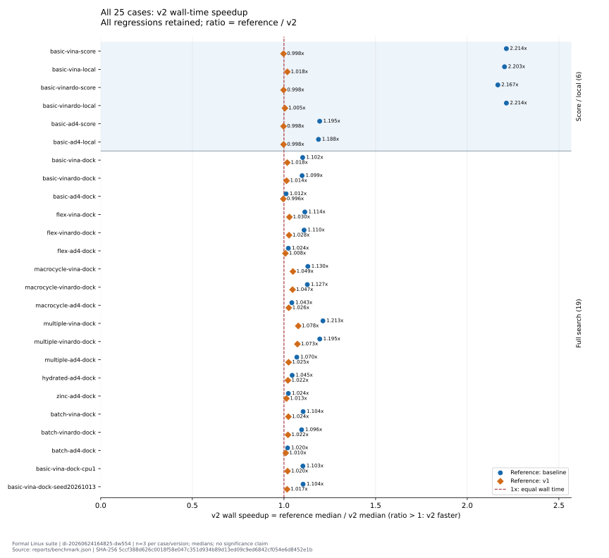
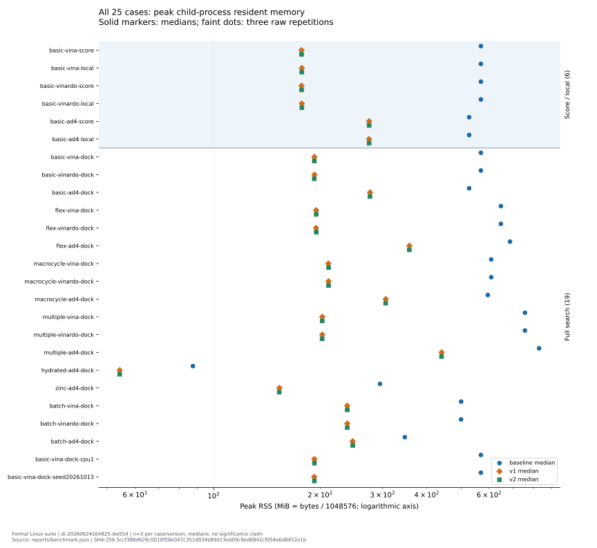

# 基准结果与证据范围

本页记录选定最终 D 版本的历史服务器测量。它区分相对上游的累计改进，以及 D 相对第一阶段优化 v1 的新增改进。本仓库只发布最终 D 源码，基线与 v1 用于解释比较结果。

## 实验方法

| 项目 | 设置 |
| --- | --- |
| CPU | Intel Xeon Platinum 8362 |
| CPU affinity | 逻辑 CPU 16–19；共享服务器，未声明独占 |
| 工具链 | GCC 11.4、Boost 1.82 |
| 重复次数 | 每个案例、每个版本 3 次 |
| 执行方式 | 串行执行，轮换版本顺序，无预热 |
| 搜索设置 | 完整对接 `exhaustiveness=32`、`max_evals=0`，显式指定 `cpu=1` 或 `cpu=4`，固定随机种子 |
| 汇总方式 | 每个案例先取 3 次墙钟时间中位数；完整对接汇总为 19 个中位数之和 |

25 个案例的原始重复数据见 [`benchmark.csv`](../benchmarks/benchmark.csv)，执行记录见 [`runs.csv`](../benchmarks/runs.csv)，汇总见 [`summary.json`](../benchmarks/summary.json)。来源及文件对应关系见 [`source-manifest.json`](../benchmarks/source-manifest.json) 和 [PROVENANCE](PROVENANCE.md)。

这些结果描述上述固定环境；没有据此推断其他处理器、编译器、线程数或未测分子上的加速幅度。README 的 `exhaustiveness=8` 示例用于演示，参数与本节历史基准不同。

## 完整对接时间

| 版本 | 19 个案例中位数之和（秒） | 相对上游耗时降低 | 相对 v1 耗时降低 |
| --- | ---: | ---: | ---: |
| 上游基线 | 3242.524748 | — | — |
| v1 | 3074.107266 | 5.19% | — |
| 最终 D | 2989.230831 | 7.81% | 2.76% |

耗时降低按 `1 − 新版本耗时 / 参照版本耗时` 计算。以这些合计值计算，D 相对上游的加速比约为 1.085 倍；7.81% 是耗时降低比例，不是加速比增加比例。这里也未将逐案例加速比做几何平均。

D 在 19/19 个完整对接案例上快于上游，在 18/19 个案例上快于 v1；`basic-ad4-dock` 相对 v1 约慢 0.36%。3 次重复有助于降低单次波动的影响，但不能替代更多重复或跨机器验证。

另有 6 个只评分／局部优化配置，单独统计，没有并入上述 19 项完整对接汇总。其中 `basic-vina-score`、`basic-vinardo-score`、`basic-ad4-score`、`basic-ad4-local` 相对 v1 略慢；所有原始值和回退项均保留在 CSV 与 `summary.json` 中。该共享服务器上的三次重复属于描述统计，未作统计显著性结论。

## 峰值内存

在 19 个完整对接案例上，D 的峰值 RSS 相对上游降低 28.71%–73.27%。这是包含 v1 已有查表共享、减少复制等修改的累计结果，不能全部归因于 D 的 BFGS 修改。

相对 v1，在全部 25 个案例上，D 的峰值 RSS 为 12 个更低、11 个更高、2 个相同，差值范围为 −0.21875 至 +0.265625 MiB。D 为 BFGS 使用完整对称矩阵和临时缓冲区，本身增加局部存储需求；这组小幅 RSS 变化不支持“D 持续降低内存”的结论。

## 等价性检查

| 检查 | 历史证据 |
| --- | --- |
| CLI | 225 次执行：PDBQT 逐字节一致，日志结果等价 |
| API | 75 次检查：十六进制 double 能量值、可获取的坐标完全一致 |

CLI 和 API 检查提供不同层次的证据：CLI 输出一致可验证实际文件结果；API 的十六进制 double 比较可检查打印舍入掩盖的差异。检查范围以记录中的输入和配置为限。

边界如下：

- 多配体、柔性受体和局部搜索场景的坐标 getter 覆盖不完整；“可获取的坐标一致”不代表已穷尽内部所有坐标。
- Python binding 和 `--write_maps` 未测试。
- 历史非有限值案例出现过 NaN 符号差异，不宣称所有 IEEE 浮点特殊值逐位一致。
- 已测案例的等价性不构成所有输入、平台、编译器或优化选项的普遍证明。

## 复测时保持的条件

复测应使用同一输入集、种子、搜索参数、CPU affinity 和线程数，并为各版本采用一致的工具链与编译参数。先检查输出等价性，再比较完整对接时间。请保留每次执行的原始时间、峰值 RSS、命令和输出，而不仅记录汇总百分比。

本仓库的构建脚本保留双精度与搜索逻辑，不启用 `fast-math` 等浮点数学改写。历史服务器测量与本仓库发布构建的实际验证应分别记录；历史结果不能自动视为在新机器上复现成功。
