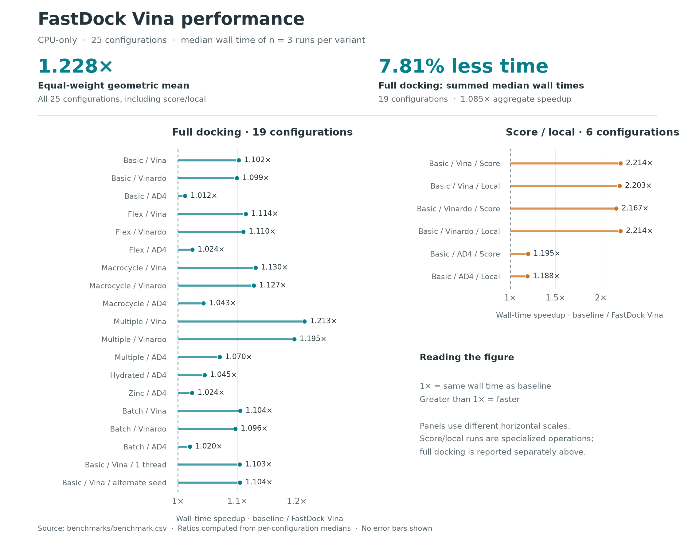
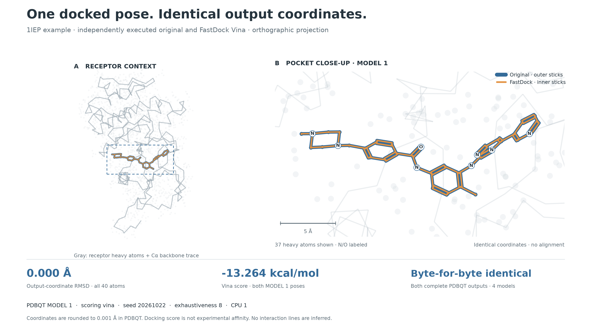

# 图表与数据

README 中的两张图均由已保存的实验数据生成。性能图使用服务器基准；构象图使用发布前的 macOS 示例验证，两组实验分别记录。

## 加速比图



来源是 [`benchmark.csv`](../benchmarks/benchmark.csv)。脚本重新计算每个版本、每项测试的三次耗时中位数，再以原版中位数除以 FastDock 中位数得到加速比。

- 全部 25 项（19 项完整对接、6 项评分／局部优化）的等权几何平均：**1.2283158587×**。
- 19 项完整对接的中位数之和：**3242.524748 → 2989.230831 秒**，耗时降低 **7.8116%**，对应 **1.084735×**。
- 图中 1× 表示耗时相同；两个面板使用不同横轴刻度，逐项数值均标出。没有绘制误差条；原始三次测量保留在 CSV 中。

## 对接构象图



使用仓库自带的 1iep 输入及 README 的运行参数：`scoring=vina`、`seed=20261022`、`cpu=1`、`exhaustiveness=8`。发布前分别运行原版与 FastDock，两个完整 PDBQT 文件逐字节相同，均包含 4 个构象；图中展示 MODEL 1，其 Vina 分数为 **−13.264 kcal/mol**。

图是三维输出坐标的正交投影。蓝色外侧线与橙色内侧线分别绘制原版、FastDock 的坐标；两者使用同一视角，没有做结构对齐。全部 40 个原子的输出坐标 RMSD 为 **0.000 Å**。视图显示 37 个重原子，灰色背景为受体重原子及 Cα 骨架轨迹。

配体的 44 条键来自原始 SDF 的连接表与原子映射，已逐项核对，绘图时隐藏氢原子及其键。没有通过对接后的原子距离猜测配体化学键，也没有生成受体与配体之间的相互作用线。PDBQT 坐标记录到 0.001 Å；此图验证已输出坐标的一致性，Vina 分数不是实验亲和力测量。

| 数据 | 内容 |
| --- | --- |
| [1iep_docked.pdbqt](../examples/basic/1iep_docked.pdbqt) | FastDock 的完整实际输出，含 4 个构象 |
| [1iep_topology.json](../examples/basic/1iep_topology.json) | 原子身份、键连接、SDF 映射和来源哈希 |
| [docking-figure.json](../benchmarks/docking-figure.json) | 独立原版运行的 MODEL 1 坐标、两版输出哈希、参数和比较结果 |
| [release-validation.json](../benchmarks/release-validation.json) | 发布时的编译、评分及完整对接验证记录 |

## 重新生成

使用 Python 3.10+，在仓库根目录执行：

```bash
python3 -m pip install numpy matplotlib
python3 tools/plot_speedup.py
python3 tools/plot_docking.py
```

脚本读取仓库内的数据并重新核对数值、输入哈希或坐标身份，输出 PNG 与 SVG 到 `docs/figures/`。绘图无需重新运行 docking，也不参与性能计时。
